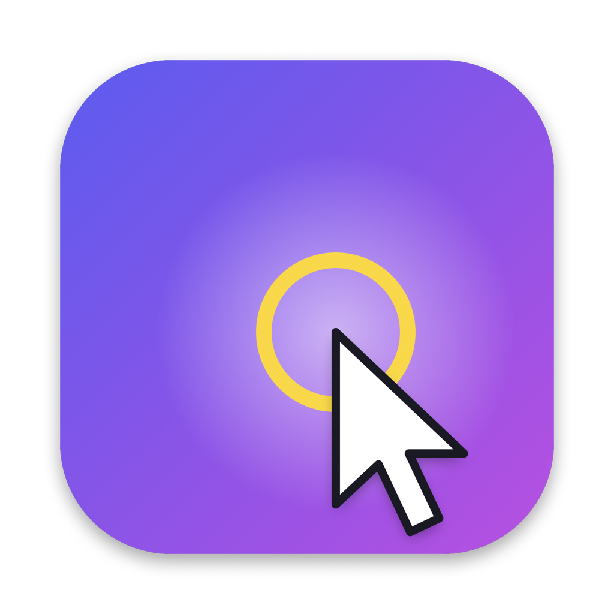
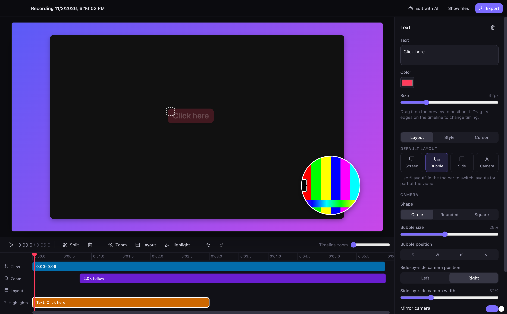
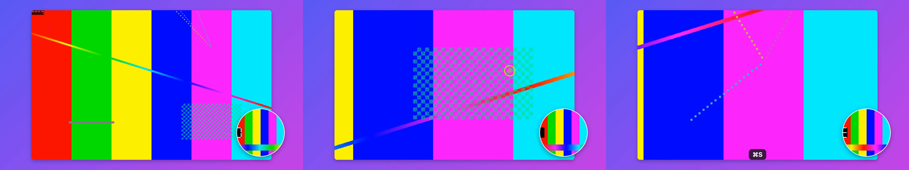

<p align="center">
  
</p>

<h1 align="center">Spotlight Studio</h1>

<p align="center">
  A free, open-source screen recorder for product demos.<br/>
  Record your screen and camera, and it zooms in where you click so viewers can follow along.
</p>

<p align="center">
  <a href="https://github.com/seaver-choy/spotlight-studio/releases/latest">Download for macOS</a> ·
  <a href="#features">Features</a> ·
  <a href="#edit-with-ai">Edit with AI</a> ·
  <a href="docs/google-drive.md">Google Drive</a> ·
  <a href="CONTRIBUTING.md">Contributing</a>
</p>



## Features

**Record**
- Record a whole display or a single window, along with your webcam and microphone.
- A floating camera bubble lets you see yourself while recording. It's hidden from the capture, so it never ends up in the video twice.
- 3-2-1 countdown, pause/resume, restart, and a mic level meter. Press **⌘⇧R** to start or stop from anywhere.

**Keep the focus on the mouse**
- **Auto-zoom.** Clicks are grouped into zooms that ease in and then follow your cursor smoothly. A dead-zone and spring smoothing keep the camera from jittering.
- **Click ripples, cursor glow and spotlight** (dims everything except the area around the cursor).
- **Keyboard shortcut overlay** that shows the ⌘/⌃/⌥ combos you press. Plain typing is never recorded.

**Layouts**
- Screen only, picture-in-picture, side by side, or camera only. You can switch layouts partway through the video, and the change animates.
- Bubble shape, size, position, border and mirroring. Drag the bubble around in the preview.
- Backgrounds (gradients, solid colors or your own image), padding, rounded corners and shadow.
- 16:9, 9:16 (Shorts/Reels), 1:1 and 4:3 output.

**Edit**
- Timeline with clips, zooms, layouts and highlights. Trim, split (**S**), delete, and change speed (0.5×–4×).
- Highlights: text callouts, arrows, boxes, a focus area (dims everything else), and a blur box for redacting sensitive information.
- Unlimited undo/redo, autosave, and keyboard-driven editing.
- **Nothing is baked in.** The screen, camera and cursor are recorded separately, so you can change the layout, the zooms or anything else after recording.

**Export**
- MP4 (H.264 + AAC) at 720p, 1080p, 1440p or 4K, at 30 or 60 fps, using hardware encoding.
- The exporter and the preview use the same renderer, so the export matches the preview exactly.

**Share**
- **Upload to Google Drive** when you export. The share link is copied to your clipboard when the upload finishes, like Loom. The app can only access files it uploads (`drive.file`). See [docs/google-drive.md](docs/google-drive.md).



## Install

Download the `.dmg` for your Mac (Apple Silicon: `arm64`, Intel: `x64`) from the [latest release](https://github.com/seaver-choy/spotlight-studio/releases/latest) and drag the app into Applications.

> **The app isn't notarized yet**, so macOS will say it "can't be opened" the first time. Right-click the app, choose **Open**, then confirm **Open**. If that doesn't work, run:
> ```sh
> xattr -dr com.apple.quarantine "/Applications/Spotlight Studio.app"
> ```

On first launch, grant the permissions the app asks for:

| Permission | Why |
| --- | --- |
| Screen Recording | To capture your screen |
| Camera / Microphone | To record your face and voice |
| Accessibility | To capture **clicks** for auto-zoom and ripples, plus keyboard shortcuts. Optional. |

After turning on Screen Recording or Accessibility in System Settings, quit and reopen the app.

## Edit with AI

Every edit is stored in a plain `project.json` next to your recording, and each recording folder includes an `AGENTS.md` that documents the format. That means a coding agent such as [Claude Code](https://claude.com/claude-code) can edit your video for you, using your own account and with no API key in the app. The editor reloads changes live, and ⌘Z undoes them.

```sh
cd ~/Movies/"Spotlight Studio"/"2026-11-02 18.12.50"
claude
> Cut the dead air at the start, speed up the parts where I'm not moving the mouse,
> and add a "Click Save" callout one second before I click the Save button.
```

Click **Edit with AI** in the editor to copy the command for the recording you have open.

## How it works

```
Recording                       Editing                                Export
─────────                       ───────                                ──────
screen.mp4  (screen + mic)  ─┐
camera.mp4  (webcam)        ─┼─▶  project.json  ─▶  renderFrame()  ─▶  WebCodecs H.264/AAC ─▶ .mp4
cursor.json (60 Hz + clicks)─┘    (all edits)       (shared by preview and export)
```

- **Electron + React + TypeScript.** Capture uses Chromium's `MediaRecorder`; cursor positions are polled in the main process, and clicks come from [`uiohook-napi`](https://github.com/SnosMe/uiohook-napi).
- [`mediabunny`](https://mediabunny.dev) remuxes recordings, decodes frames and encodes the export, all through WebCodecs, so no ffmpeg binary is bundled.
- The zoom camera, layouts and time mapping are pure functions in [`src/shared`](src/shared). That keeps them unit-testable and makes every frame deterministic.

More detail is in [docs/architecture.md](docs/architecture.md).

## Build from source

Requires Node 22+ and pnpm 10+.

```sh
git clone https://github.com/seaver-choy/spotlight-studio.git
cd spotlight-studio
pnpm install
pnpm dev            # run with hot reload
pnpm test           # unit tests
pnpm test:e2e       # end-to-end test (needs ffmpeg to generate a fixture recording)
pnpm dist:mac       # build .dmg files into dist/
```

To enable Google Drive upload in your own build, create a Google OAuth "Desktop app" client and put its ID and secret in `.env.local`. [docs/google-drive.md](docs/google-drive.md) has the steps.

## Roadmap

- [ ] System audio capture (ScreenCaptureKit)
- [ ] Hide the system cursor and render a smoothed or enlarged cursor
- [ ] Windows and Linux builds
- [ ] GIF export
- [ ] Transcripts, captions and "remove filler words"
- [ ] Audio waveform on the timeline
- [ ] Notarized builds and Homebrew cask

Ideas and pull requests are welcome. See [CONTRIBUTING.md](CONTRIBUTING.md).

## License

[MIT](LICENSE)
